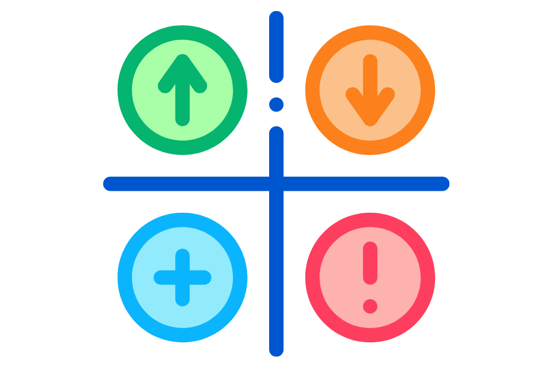
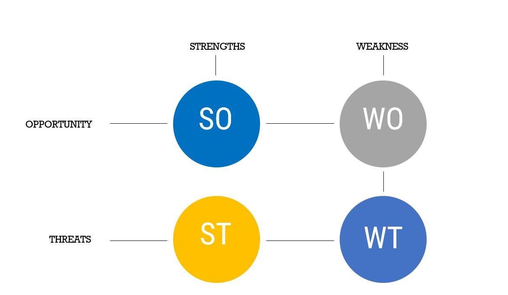

## Cosa è una Strategia Digitale?

La **Strategia Digitale** è lo studio, pianificazione ed implementazione sul web di un insieme di azioni  Strategiche per il Marketing e la Comunicazione aziendale, in accordo con il **modello di business** definito.

Un ruolo sicuramente importante nel contesto della Strategia Digitale è rivestito dalle **tecnologie** **digitali,** ma occorre evitare di incappare nel “tranello” che spinge i non addetti ai lavori (e anche qualche addetto purtroppo) ad associare il concetto di  “Strategia Digitale” unicamente alla tecnologia.

Nella gestione del Piano Marketing questo significa utilizzare in maniera **analitica** e consapevole la tecnologia con il fine ultimo di **incrementare il business dell’azienda**.

All’atto pratico, quanto detto sopra ha un significato molto semplice:

> Considerando che non si può più fare a meno di Internet per fare business, e considerando che tutti i nostri **competitor utilizzano Internet per il nostro stesso scopo**, occorrerà **studiare una strategia** prima di utilizzare la tecnologia. Diversamente, utilizzare la tecnologia senza una Strategia significa sprecare denaro.

## Quali sono i principali elementi di una Strategia Digitale?

Se la “Strategia Digitale” non è solo “tecnologia” allora cosa significa?

Significa **affrontare una fase di studio** PRIMA di metter mano alle azioni pratiche sul web: lo studio “poggia” su alcuni pilastri fondanti della Strategia Digitale di una azienda che non possono essere trascurati.

Vediamoli nel dettaglio

### Mission aziendale

La “Mission” non è un concetto “aulico” come in tanti pensano.

Il concetto alla base è tanto semplice quanto potente: la “Mission” serve a isolare, definire e soprattutto descrivere e documentare la vera “ragione d’esistere” della tua azienda.

La “**Mission**” non è “vendere”, ma la **motivazione** che sostiene la tua azienda, ispirandone i prodotti e servizi che proponi.

Perché è importante aver definito una “Mission”?

Perché, consente di dare un solido sostegno a tutte le iniziative di Comunicazione e Marketing, rendendo il Piano Marketing perfettamente orientato verso la “Direzione giusta”.

Un esempio? La seguente potrebbe essere la Mission di una azienda che produce un software per la contabilità:

_“Semplificare la gestione delle pratiche amministrative e fiscali, liberando risorse interne dell’azienda e aiutandola a raggiungere elevati standard di compliance fiscale e legale”_

Come vedete nell’esempio sopra, nella Mission non si fa menzione della “produzione del software” né degli obiettivi economici, e questo consente all’azienda di andare esattamente nella direzione del “soddisfare le necessità” dei potenziali clienti rispetto a una certa problematica.

Altro vantaggio della “Mission” è quello di rendere l’azienda flessibile rispetto al prodotto o servizio che si intende vendere, purchè questo vada nella direzione “cliente-centrica”.  

### Vision aziendale

La vera e propria “bussola” dell’azienda.

Come si può intraprendere un viaggio senza sapere dove si sta andando?

Dove vedi l’azienda l’anno prossimo o tra 5 anni?

Tutte le azioni che compi nel contesto del Marketing e Comunicazione Digitale, sono compatibili con la “destinazione” che vuoi raggiungere con la tua azienda?

Un esempio di Vision?

_“Diventare per le PMI il punto di riferimento a livello nazionale per tutte le problematiche relative agli aspetti fiscali nell’internazionalizzazione delle aziende”_

Il Piano Marketing e gli investimenti che la tua azienda ha messo a budget sono compatibili con questa visione?  

### Competitor

“Conosci il competitor tuo come te stesso”

Tutte le aziende, in varia misura, si confrontano con il tema della Competition.

Ma quanti conoscono veramente i competitor?

Sei veramente sicuro di sapere tutto ciò che c’è da sapere sui tuoi competitor?

Conoscere i concorrenti significa intanto saperli elencare, sia quelli diretti che quelli indiretti.

C’è un concetto molto importante e altrettanto trascurato: un competitor non lo si identifica solamente sulla base dei prodotti e servizi offerti che coincidono con ciò che vende la tua azienda, ma un competitor lo si identifica principalmente sulla base delle necessità dell’utente. Ad esempio, l’esigenza che una persona ha di trovare l’intrattenimento per la domenica pomeriggio, può essere soddisfatta sia dai teatri che dai cinema o addirittura dagli artisti di strada; sotto questo profilo, se sei proprietario di un cinema puoi affermare con sicurezza che gli unici tuoi competitor siano gli altri cinema?

Superato il problema dell’elenco dei competitor, sia diretti che indiretti (ovvero che offrono servizi diversi per uno stesso problema del potenziale cliente, come da esempio sopra), è ora di conoscere nel dettaglio tutte le caratteristiche del concorrente, con l’obiettivo di trovare il Sacro Graal del “Fattore Differenziante” che rende la tua azienda unica. Trovare un valido “Fattore Differenziante” della tua azienda significa essere veramente sulla buona strada, altrimenti la tua azienda sarà solamente “una delle tante”. Senza fattore differenziante non si va da nessuna parte.

Ma non basta ancora.

La conduzione del Marketing Aziendale deve NECESSARIAMENTE dotarsi di un processo di monitoraggio costante dei concorrenti, con l’obiettivo di mantenere l’azienda “in gara” ed eventualmente anticipare i competitor nelle loro strategie o addirittura conquistare quote del suo mercato nelle fasi calanti del concorrente.

Sul monitoraggio dei competitor, aspetto importante e delicato, oltre a tutte le possibili azioni “offline”, la tecnologia può veramente essere uno strumento vitale, attraverso:

-   Monitoraggio della SEO della tua azienda e dei competitor
-   Monitoraggio social dei competitor
-   Monitoraggio delle campagne pubblicitarie dei competitor

### Posizionamento dell’azienda

Sul Posizionamento alcuni luminari del Marketing hanno scritto libri che hanno fatto la storia.

Descrivere l’importanza del posizionamento in un post di blog è sicuramente pretenzioso, ma è anche vero che se sei un imprenditore è quantomeno importante conoscere le basi ed assicurarsi che l’azienda abbia definito correttamente e coerentemente un posizionamento.

Durante le mie consulenze mi è capitato spesso di sentirmi dire da alcuni imprenditori che “Posizionamento” significa “Quanto sei grande nel tuo mercato di riferimento”. Non è esattamente questa l’essenza del concetto di posizionamento, concetto enormemente più vasto e che tocca la sfera della percezione, della comunicazione, delle neuroscienze… Ho trattato in maniera semplice e per sommi capi questo tema [in questo articolo](/articoli/posizionamento-perche-importante/) che ti invito a leggere

### Buyer persona (target o potenziali clienti)

Sullo studio del “target”, quello che in gergo viene definito “Buyer persona” cascano in tanti.

Esiste purtroppo la pessima abitudine nel dire che “identificare il target” significhi conoscerne il genere, l’età e il titolo di studio. Niente di più approssimativo..

Conoscere la buyer persona significa molto molto moltissimo di più.

Devi sapere quali sono i suoi problemi, quali sono i suoi obiettivi professionali, le sue paure, i suoi desideri sia privati che professionali, i suoi hobby, le sue passioni, i suoi gusti e tante altre cose, in modo tale da costruire una “superficie di contatto” con il tuo target quanto più vasta possibile.

I mercati sono conversazioni, e le aziende prima di vendere devono “parlare” con i potenziali clienti. Quanti più argomenti di conversazione si hanno, quanti più “nervi scoperti” si toccano, quanta più empatia in generale viene messa sul piatto, tanto maggiori saranno le chance di condurre una conversazione fino alla vendita.

### Analisi dei Punti di forza e dei Punti deboli (SWOT Analysis)

I fan delle arti marziali sanno bene che uno dei principali insegnamenti è quello di “sfruttare la forza dell’avversario” per compensare le proprie debolezze.

Ebbene il ragionamento da fare quando si parla di “SWOT” analysis per certi versi ricalca questa filosofia orientale.

Innanzitutto, SWOT è un acronimo che sta per:

-   Strengths
-   Weaknesses
-   Opportunities
-   Threats

Semplicemente traducendo il significato dei termini sopra diviene abbastanza immediato capire di cosa si tratta.

Tutte le aziende devono conoscere i propri punti di forza, per sfruttarli e renderli ben visibili, ed allo stesso modo devono conoscere tutti i propri punti deboli, con l’obiettivo di riuscire a mitigarli opportunamente.

Stai mettendo in chiara evidenza nella comunicazione online tutti i punti di forza della tua azienda?

Hai messo in pratica le giuste contromisure per evitare che i punti deboli della tua azienda causino impatti troppo alti?

Per quanto riguarda le opportunità che il mercato offre, è estremamente importante conoscerle per capire se la tua azienda può trarne beneficio attraverso i suoi punti di forza oppure se può essere utile perseguirle  per mitigare i punti deboli.

Tutti i mercati, inoltre, presentano diverse “minacce”: ad esempio, tanti anni fa, con la comparsa dei primi lettori MP3 costituiva una minaccia per il business del Walkman (ve lo ricordate?) e delle audiocassette.

Conoscere le minacce significa anche capire in che modo difendersi a partire dai punti di forza individuati e, non ultimo, individuare le opportune strategie di difesa per evitare che le minacce vadano a “scalfire” ulteriormente i punti deboli dell’azienda.Se sei interessato ad approfondire nel dettaglio tutti questi aspetti legati agli “Elementi di base” di una Strategia Digitale, puoi accedere al mio corso

“Pianificare una Strategia Digitale”

acquistando una membership che ti darà la possibilità di usufruire anche di contenuti futuri della mia Academy.

Per dettagli sul costo e sulle promozioni attive visita la mia “Marketing Academy per Imprenditori” su Esmerise cliccando il pulsante seguenteDesideri fare un approfondimento sugli elementi di base di una Strategia Digitale e su come contestualizzarli alla tua azienda?

Contattami, sono a disposizione per aiutarti
